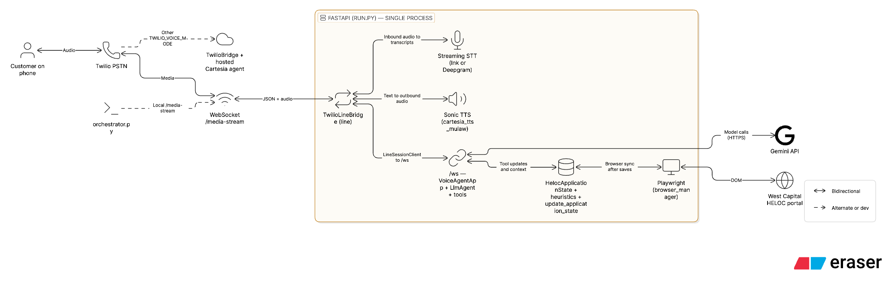

# AI Voice Gateway

HELOC phone intake for **West Capital Lending** on the default telephony stack: Twilio **µ-law** audio **→** switchable streaming STT (**Cartesia Ink** by default via [`app/cartesia_stt_client.py`](app/cartesia_stt_client.py), or **Deepgram Flux** via [`app/deepgram_stt_client.py`](app/deepgram_stt_client.py)) **→** **Cartesia Line** `LlmAgent` on **`/ws`** (Gemini **on your server**) **→** **Cartesia Sonic** TTS ([`app/cartesia_tts_mulaw.py`](app/cartesia_tts_mulaw.py)) **→** Twilio. [`app/twilio_line_bridge.py`](app/twilio_line_bridge.py) + [`app/line_session_client.py`](app/line_session_client.py) implement that path. **Playwright** syncs the WCL form via [`agent/state_manager.py`](agent/state_manager.py).

Set `TWILIO_VOICE_MODE` to anything other than `path2`, `line`, or `local` to use [`app/twilio_bridge.py`](app/twilio_bridge.py) instead: audio goes to Cartesia’s fully hosted agent (no server-side `LlmAgent` or Playwright sync, and no Ink/Sonic clients from this repo).

## Architecture

Default stack (Twilio or orchestrator → same `/media-stream` bridge). **`Line /ws`** and **`LlmAgent`** run in the **same FastAPI process** as [`run.py`](run.py); [`LineSessionClient`](app/line_session_client.py) opens an outbound WebSocket to that endpoint.

The bridge may run **pre-line heuristics** that update application state before sending a user turn to Line ([`apply_voice_intake_heuristics_before_line`](agent/state_manager.py)). **Alternate `TWILIO_VOICE_MODE`:** [`TwilioBridge`](app/twilio_bridge.py) sends µ-law to Cartesia’s hosted agent only.

### High-level architecture



### Low-level architecture

[Open low-level architecture diagram (PNG)](docs/architecture/lld-voice-heloc.png)

Diagrams are versioned under [`docs/architecture/`](docs/architecture/); replace the PNGs with exports from your source when the pipeline changes.

## Prerequisites

- Python **3.11+** (3.13: see `requirements.txt` for `audioop-lts` where needed)
- **Cartesia** API key (speech services)
- **Gemini** `GEMINI_API_KEY` (server-side `LlmAgent` in Line)
- **Twilio** number + webhook for real PSTN tests
- **Playwright** Chromium if you use browser sync: `playwright install chromium`

## Setup

```bash
python3 -m venv venv && source venv/bin/activate
pip install -r requirements.txt
```

Create **`.env`** in the repo root (never commit). Common variables:

| Variable | Purpose |
| --- | --- |
| `GEMINI_API_KEY` | LLM |
| `CARTESIA_API_KEY` | Ink STT + Sonic TTS (bridge path) or hosted agent. Still required for Sonic TTS when using Deepgram STT. |
| `TWILIO_VOICE_MODE` | `path2` (default), `line`, `local` → bridge uses Ink + Sonic modules + Line `/ws` + server-side `LlmAgent`; otherwise → hosted Cartesia agent bridge |
| `PATH2_STT_PROVIDER` | `cartesia` (default) or `deepgram` for STT only |
| `DEEPGRAM_API_KEY` | Required only when `PATH2_STT_PROVIDER=deepgram` |
| `HOST`, `PORT` | Bind for [`run.py`](run.py); default `0.0.0.0:8000` |
| `CARTESIA_STT_MAX_SILENCE_SECS` | Silence before STT final (default ~0.45) |
| `DEEPGRAM_STT_MODEL` | Deepgram Flux model when provider is `deepgram`; default `flux-general-en` |
| `DEEPGRAM_STT_EOT_THRESHOLD`, `DEEPGRAM_STT_EAGER_EOT_THRESHOLD`, `DEEPGRAM_STT_EOT_TIMEOUT_MS` | Deepgram Flux end-of-turn tuning |
| `DEEPGRAM_STT_KEYTERMS` | Optional comma-separated Deepgram keyterms, e.g. domain words or names |
| `CARTESIA_TTS_SPEED`, `CARTESIA_TTS_VOLUME` | Sonic tuning ([`app/cartesia_tts_mulaw.py`](app/cartesia_tts_mulaw.py)) |
| `TWILIO_CALLER_RESPONSE_WATCHDOG_SECS` | Seconds to wait after an agent prompt before repeating it if no user final is handled; default `10.0` |
| `TWILIO_PREFILL_BY_PHONE_JSON` | Optional JSON string: map **caller phone** (digits, `+1…`, etc.) → object of HELOC field keys (`address_line_1`, `first_name`, …). Used on `GET /voice` / `POST /voice` to prefill before Line starts. |
| `TWILIO_PREFILL_BY_PHONE_FILE` | Optional filesystem path to the **same** JSON shape when the env var above is empty (e.g. `data/prefill/customers.json` locally; file is gitignored). |
| `PATH2_WAIT_FOR_ADDRESS_SYNC` | Default `1`: after `address_line_1` updates on the property stage, state may wait for browser sync. Set `0`/`false`/`no` to skip that wait. |
| `PATH2_DETERMINISTIC_ADDRESS` | Default `0`. Set `1`/`true`/`yes` to use deterministic address parsing in state (see `agent/state_manager.py`). |
| `LINE_POST_FALLBACK_MUTE_SEC` | After tool-ask **fallback** TTS, seconds to drop late LLM text (default **6**; see [`app/line_session_client.py`](app/line_session_client.py)). |

Optional observability:

| Variable | Purpose |
| --- | --- |
| `CONVERSATION_TRANSCRIPT_DIR` | NDJSON per call (`data/conversations` if unset; empty = off) |
| `INTAKE_AUDIT_NDJSON_DIR` | Optional intake audit `.jsonl` per `call_sid` |
| `VOIP_LOG_FORMAT` | `json`, `human`, or `auto` (default): stderr log shape for `voip.*`; `auto` uses human lines on a TTY. Log file stays JSON. |
| `VOIP_CONSOLE_SHOW_INGRESS` | Set `1` to print every Twilio media ingress sample on the console in human mode (noisy). |
| `VOIP_CONSOLE_SHOW_PATH2_DEBUG` | Set `1` to print `voip.path2_debug` lines on the console in human mode. |
| LLM per-turn state snapshot | On by default; optional disable via env — see [`agent/main_agent.py`](agent/main_agent.py) |

[`run.py`](run.py) loads `.env` before the app starts.

### Customer prefill

For **Twilio**, [`app/main.py`](app/main.py) can attach known customer fields to the media-stream `<Stream>` as **base64 JSON** (`prefill_b64`) plus `caller_from` / `caller_to`. Values come from (in order): **phone-keyed** lookup (`TWILIO_PREFILL_BY_PHONE_JSON` or `_FILE`), then **query string** / **form** fields on `/voice` (allowed keys include `address_line_1`, `first_name`, …), then `prefill_json` / `prefill_b64` query parameters for ad-hoc payloads. [`TwilioLineBridge`](app/twilio_line_bridge.py) decodes `prefill_b64` into `customer_prefill` and passes it in **call metadata** to [`LineSessionClient`](app/line_session_client.py); [`agent/main_agent.py`](agent/main_agent.py) calls `set_customer_prefill` so [`agent/state_manager.py`](agent/state_manager.py) can seed state and drive **on-file confirmation** before saving. Tracked example shape: [`data/prefill/customers.example.json`](data/prefill/customers.example.json).

## Run the server

```bash
python run.py
```

**HTTP/WebSocket:** `GET /voice` (TwiML), `WS /media-stream`, `GET /health`, `GET /docs`, Line **`WS /ws`**, optional transcript debug socket (see [`app/main.py`](app/main.py)).

## Voice without a phone (dev)

**Orchestrator** connects to **`WS /media-stream`** (same entry point as Twilio), so it runs **[`TwilioLineBridge`](app/twilio_line_bridge.py)** — the same STT provider selected by `PATH2_STT_PROVIDER` and **Sonic** TTS code as a real call ([`app/cartesia_stt_client.py`](app/cartesia_stt_client.py), [`app/deepgram_stt_client.py`](app/deepgram_stt_client.py), [`app/cartesia_tts_mulaw.py`](app/cartesia_tts_mulaw.py)), then Line **`/ws`** and the same `LlmAgent`.

```bash
# terminal 1
python run.py
# terminal 2
python agent/orchestrator.py
```

Use `/voice` in the orchestrator CLI to connect. Needs **PyAudio**, **webrtcvad**, **websockets** (see [`agent/orchestrator.py`](agent/orchestrator.py)).

**`cartesia chat` + `main_agent`** (no `/media-stream`): same **`LlmAgent`** and Line **`/ws`**, but audio is handled by the **Cartesia CLI** / Line harness — **not** [`app/twilio_line_bridge.py`](app/twilio_line_bridge.py) or the Ink/Sonic WebSocket clients above.

```bash
python -m agent.main_agent
# elsewhere: cartesia chat 8000
```

## Twilio (dev)

1. Run `python run.py` and expose **HTTPS**, e.g. `ngrok http 8000`.
2. Twilio number → **Voice webhook**: `https://<host>/voice`, method **GET** (must match [`app/main.py`](app/main.py)).
3. Call the Twilio number; Twilio opens **`wss://<host>/media-stream`**.

If audio fails, check keys, `TWILIO_VOICE_MODE`, and Twilio [Debugger](https://console.twilio.com/us1/monitor/logs/debugger). Production: stable HTTPS host, same `/voice` URL (no ngrok churn).

## Logs and transcripts

- **`voip` logs:** optional rotating file **`logs/voip.log`** (JSON; disable with `LOG_FILE_DISABLE=1`). **Stderr** uses `VOIP_LOG_FORMAT`: `auto` (default) prints human-readable lines on a TTY and JSON otherwise; `human` / `json` force one shape. See [`app/logging_config.py`](app/logging_config.py).
- **Transcripts:** with default settings, append-only **`data/conversations/*.jsonl`** (`role`: `user`, `agent`, or `ui`, plus `ts`). Directory is gitignored. Agent lines match **TTS text** sent to the caller (not necessarily every raw Line `Agent said` token).

## Tests

```bash
pytest tests/
```
